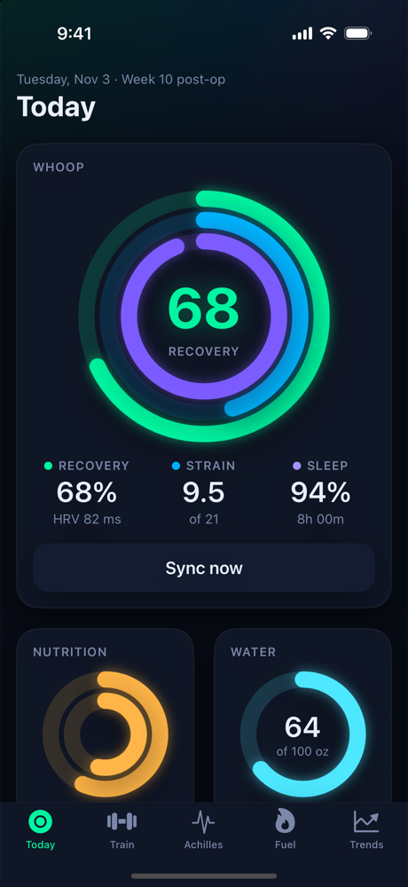
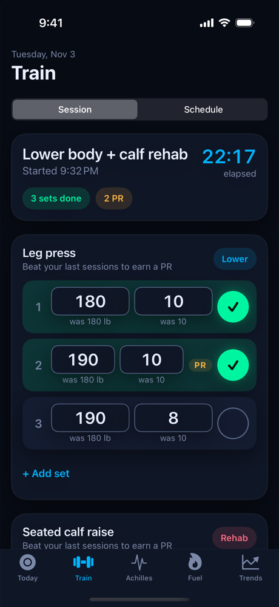
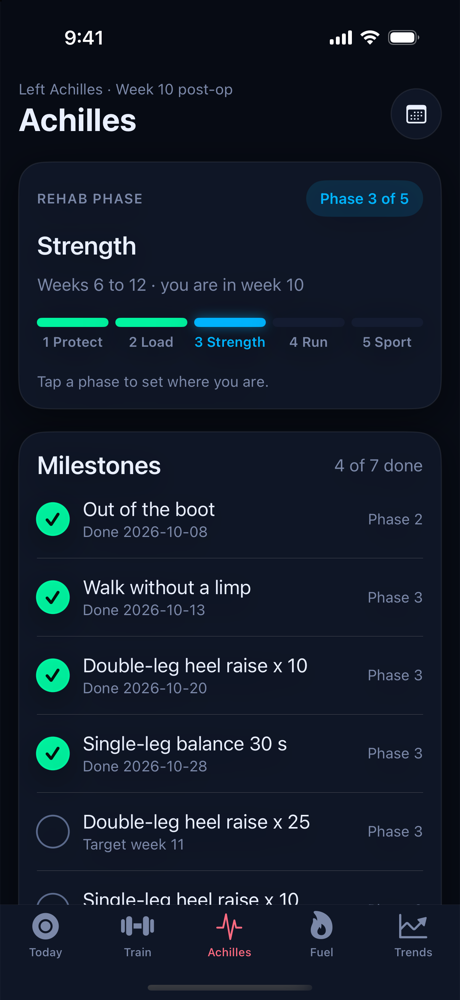
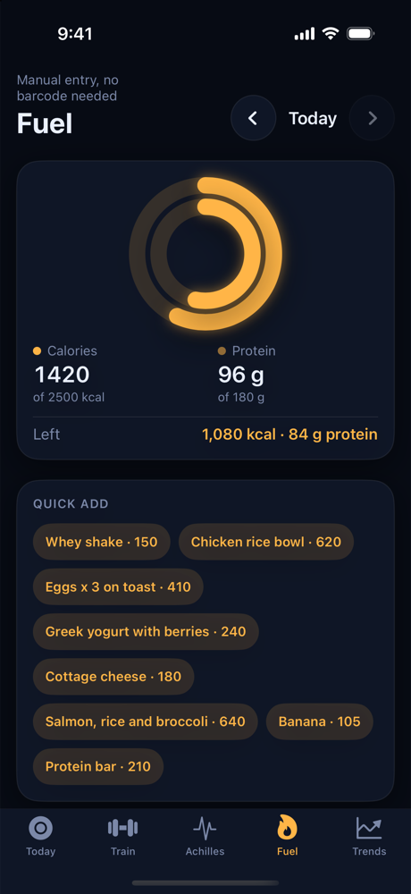
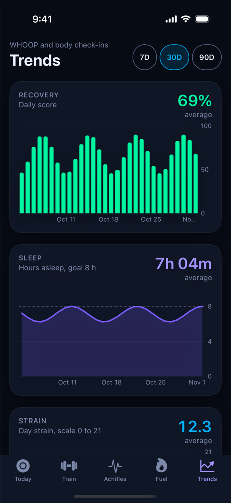

# Achilles

A free iPhone app for tracking recovery from Achilles surgery, all in one place.

  
  
  
  
  

Screenshots use made-up demo data.

## Why I made it

After surgery I wanted one spot for everything I was trying to keep track of: where I am in rehab, which milestones I've hit, how my pain and swelling are trending, how strong and mobile each side is, what I lifted, what I ate, and how my body is recovering according to my WHOOP.

Every app I looked at did one of those things, or wanted a subscription to do several. I wanted something free that tracks my recovery and milestones together, so I built it.

## What it does

- **Today:** WHOOP recovery, strain and sleep as activity rings, plus calories, protein, water, today's workout and a daily pain and swelling check.
- **Train:** a session logger with last-time values and PR badges, and a weekly schedule with planned sets and reps.
- **Achilles:** rehab phase, milestone checklist, pain and swelling trend, left and right strength and range of motion, and a PT log.
- **Fuel:** quick food entry, an end-of-day total, and daily targets.
- **Trends:** WHOOP charts, recovery against training days, and body weight and waist.

It's built for one person on one iPhone. There are no accounts, no ads and no analytics. Your data lives in your own free database.

## Setup and docs

Everything about setting it up, connecting WHOOP, and how it works is in the docs site in [`docs/`](docs). Start with [Getting started](docs/content/getting-started.mdx).

## A few honest notes

- It's a personal project. I use it and fix what breaks, and it may not fit your recovery.
- It isn't medical advice or a medical device. Follow your surgeon and physical therapist.
- The database has no sign-in yet. Read the [security notes](docs/content/security.mdx) before storing anything you care about.
- The rehab phases and milestones are placeholders. Replace them with your own plan.

## Built with

SwiftUI and Swift Charts, Supabase, and the WHOOP API.

## License

[MIT](LICENSE)
